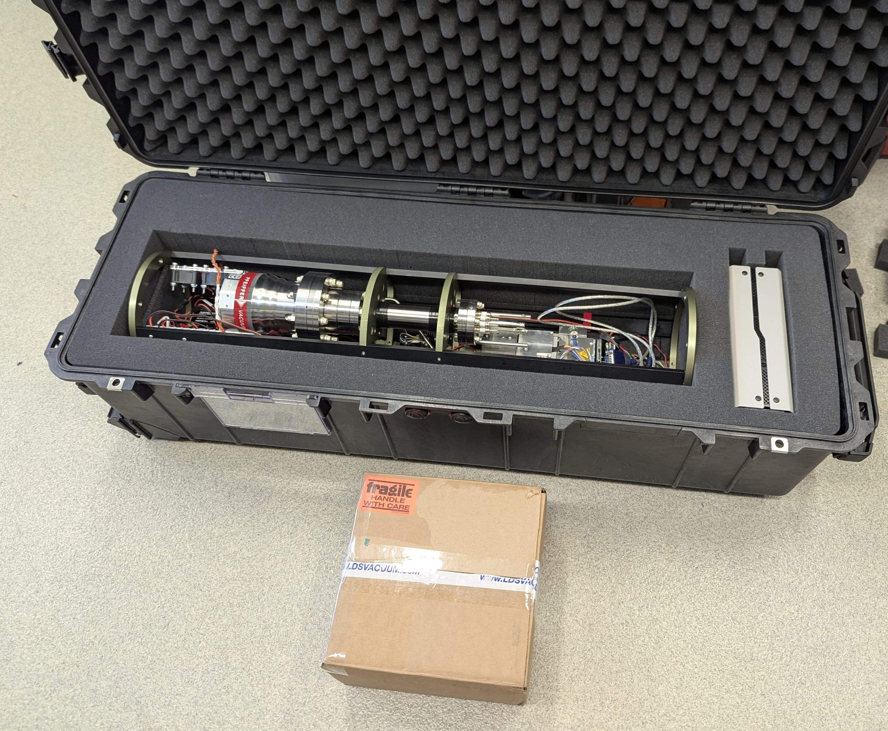

# In-Situ Mass Spectrometer V2.5 (IFREMER)

NOTE this branch is specifically for the 2026 ISMS made for IFEMER.
The main branch is for the current standard version of the ISMS made by the Girguis Lab (V3)

IFREMER-specific documentation and notes can be found in the Ifremer-documentation folder. Other documenation found in (/Documentation) does not apply to this version.
 - [Ifremer 2026 ISMS Notes Doc](<Ifremer-isms-documentation/Ifremer 2026 ISMS Notes.docx>)
 - [Ifremer 2026 ISMS Operation Doc](Ifremer-isms-documentation/Ifremer_2026_ISMS_Operation.docx)
 - [Ifremer 2026 ISMS Modern Firmware Doc](<Ifremer-isms-documentation/Ifremer 2026 ISMS Modern Firmware Guide.docx>)

This branch contains two separate firmwares for the ISMS: 
For more details see the [Ifremer 2026 ISMS Notes Doc](<Ifremer-isms-documentation/Ifremer 2026 ISMS Notes.docx>)

- **Legacy-interface compatible version**

     Source code is found in the [Legacy-ISMS-firmware-Ifremer-2026](./Legacy-ISMS-firmware-Ifremer-2026/) folder

- **Modern interface with support for Serial Studio dashboard**

     Source code is found in the [Src](./src/) and [Lib](./lib/) folders.

### Firmware Upload Steps
Applies to uploading either legacy or modern firmware.

1. Clone or download the (Github repository)[] on the ifremer-2026-build branch.
1.  (If plugged in) unplug supply power from the normal 24-48v power inputs.
2.  Attach a USB cable from your computer to the USB-B port on the  Arduino Mega within the ISMS.
3. DISCONNECT the red & orange TTL serial wires at the Arduino pins 0 & 1 before uploading code. Once done, reconnect the TTL serial wires to the Arduino Mega shield with the red wire in Arduino pin 0 (RX0) and the orange wire in pin 1 (TX1).
    > [!IMPORTANT]
    > Firmware upload will fail if any TTL wires are connected to Arduino pins 0 & 1.
4. Upload firmware:
   - **Legacy-interface compatible version**

     Open the [Legacy-ISMS-firmware-Ifremer-2026](./Legacy-ISMS-firmware-Ifremer-2026/) folder in Arduino IDE v2.0 (or higher). Compile/upload to the onboard Arduino Mega by selecting it in the board dropdown and clicking upload. See [Getting started with the Arduino IDE v2](https://docs.arduino.cc/software/ide-v2/tutorials/getting-started-ide-v2/)

   - **Modern interface with support for Serial Studio dashboard**

     To upload this firmware, open the whole cloned/downloaded github repository in the VSCode IDE with the Platform.io extension installed (see [Installing PlatformIO](https://platformio.org/platformio-ide)). Use the upload button provided by the platformio extension (small right arrow in lower left corner of IDE, or type "> PlatformIO: Upload" in the command pallet) to upload firmware to the onboard Arduino Mega.

> [!NOTE]
> The serial connection from the Arduino USB-B port may not show the full serial output. Always prefer to use the raw TTL lines (pins 0 & 1) or RS232 connection from serial pins 0 & 1 for proper instrument CLI usage.

----
